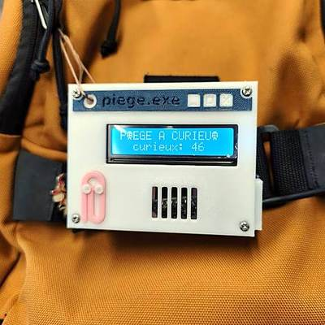

# EventBadge

A wearable portfolio badge for tech events: an ESP8266 on my bag opens a
self-declared "trap" Wi-Fi whose captive portal is a Windows 95 desktop that
introduces me and how to reach me, while an LCD invites people to connect.



**Status:** used at a real event. Day 1 (old firmware): 48 Wi-Fi connections
and 39 links copied.

## Features

- **Captive portal** that pops up on its own when a phone joins: a `piege.exe`
  Win95 window with a warning dialog, who I am, a "find me" photo, tap-to-copy
  links, a downloadable contact card and a browser self-diagnostic shown only
  to the visitor. Fully offline (inline CSS/JS, images served by the badge).
- **Rotating hotspot names** from a list (fixed / in turn / random every N
  minutes, optionally only when nobody is connected), switchable live.
- **LCD 16×2**: "connect to" + the scrolling hotspot name, name/role,
  apprenticeship search, live counters, a flashing `+1 CURIEUX !` alert.
- **Visit stats** in a flash event log, read from a key-protected `/admin`
  page: per-day connections, unique and returning visitors, per hotspot name,
  links copied, devices, time on page, connections per hour, CSV export, and
  the badge's own RAM and storage.

## Quick start

Needs `arduino-cli` with the ESP8266 core and the `hd44780` library (see
[Toolchain](#toolchain)).

```sh
cp secrets.example.h secrets.h   # set ADMIN_KEY (gitignored)
python3 web/build.py             # regenerate portal.h from web/index.html
arduino-cli compile --upload     # plain `upload` sends the last build, not the current code
```

Join one of the hotspot names from `config.h` on a phone: the portal opens on
its own (on Android a "Sign in to network" notification may need a tap). Stats:
`http://4.3.2.1/admin` with the key from `secrets.h`.

## Resources

Measured on the badge (core 3.1.2, default `4MB (FS:2MB OTA:~1019KB)` layout).

| Resource | Use | Notes |
|---|---|---|
| Sketch flash | 384 KB / 1 MB (37 %) | portal page + images ~45 KB |
| Global RAM | 32.1 KB / 80 KB (39 %) | lwIP "Higher Bandwidth" (1460-byte MSS) |
| Free heap at runtime | 42.8 KB, largest block 42.2 KB | no fragmentation; shown live in `/admin` |
| IRAM | 60.6 KB / 64 KB (92 %) | little room left for `IRAM_ATTR` code |
| Filesystem | 40 KB / 2 MB used | event log capped at 1 MB = ~65 000 events (16 B each) |
| Portal page | 10 KB gzipped + 35 KB images | from flash (`PROGMEM`); images cached by the phone, page revalidated by ETag |
| Phones at once | 8 | ESP8266 SDK maximum |
| Power (estimate) | ~80–100 mA at 5 V (~0.5 W) | Wi-Fi AP ~70 mA + LCD backlight ~20 mA; ≈ 50 h on a 10 000 mAh power bank. Not yet measured with a USB meter. |

Flash wear is kept low on purpose: log appends are batched every 3 s, counters
are saved 8 s after the last change, and `WiFi.persistent(false)` stops the SDK
from rewriting its config sector on each hotspot-name change.

## Hardware

- Wemos D1 mini (ESP8266EX, 4 MB flash, CH340 USB-serial)
- LCD1602 + PCF8574 I²C backpack (auto-detected, here 0x27)
- USB power bank in the bag, micro-USB cable to the badge
- 3D-printed Win95 window case with a Clippy inlay (FreeCAD, separate repo)

| LCD backpack | D1 mini |
|---|---|
| GND | G |
| VCC | 5V |
| SDA | D2 (GPIO4) |
| SCL | D1 (GPIO5) |

The backpack pulls SDA/SCL up to 5 V. The ESP8266 tolerates it in practice
but this is outside its spec: if the bus becomes flaky, add a BSS138 level
shifter first. The LCD is optional and hot-pluggable: the portal keeps working
without it and the screen is brought up whenever it reappears on the bus.

## How it works

- **Network:** open `WIFI_AP`, IP 4.3.2.1 (deliberately not a private address:
  some Android builds skip portal detection when the probe resolves to one). A
  catch-all DNS server plus replies to the OS connectivity probes make the
  portal open on its own. Probes and every unknown route or hostname get a
  tiny 302 to `http://4.3.2.1/`: serving the full page to each probe kept the
  single-threaded loop (DNS included) busy and made connecting slow.
- **Hotspot names** (`WifiNames.cpp`): up to 16 names saved to `/wifi.txt`.
  Defaults come from `CFG_SSIDS`; editing them in `config.h` and flashing
  replaces a list saved with older defaults. Changing the name restarts the
  AP, which drops connected phones. Every name ever used is kept so old stats
  still show names.
- **Portal** (`web/index.html` → `portal.h`): `web/build.py` gzips the page
  and turns every `assets/*.png|jpg` into its own file at a content-hash URL
  (`/i/<hash>.jpg`), cached for a year by phones. Edit `index.html` and regenerate; never
  edit `portal.h` by hand.
- **Reaching the links:** a captive-portal window has no internet and cannot
  open the real browser (Android keeps http(s) links in its own Wi-Fi-bound
  WebView; iOS stopped handing them to Safari years ago). So the page puts one
  short address forward, links are tap-to-copy (with an `execCommand`
  fallback, as the portal is not a secure context), and `/contact.vcf` lets
  visitors keep the links as a contact. On Android, Chrome reaches the copied
  link over 4G without leaving the badge's Wi-Fi.
- **LCD:** columns 0 and 15 hold glyphs only, text lives in the 14 middle
  columns, so icons never overwrite letters.

### Visit stats

The badge has no clock and no internet, so it logs `millis()` plus a boot
number; the page sends the visitor's phone clock on load and `/admin` dates
every event from the median of those clocks.

| Event | Source | Extra data |
|---|---|---|
| boot | `setup()` | |
| connect / disconnect | Wi-Fi AP callbacks | association id |
| page opened | `/hi` beacon on load | phone time, OS + browser family |
| link copied | `/click` beacon | portfolio / GitHub / LinkedIn / contact card |
| left the page | `/bye` beacon | seconds on the page |
| hotspot name | each AP (re)start | FNV-1a hash of the name |

- Records go to `/events.bin` on LittleFS (`EventLog.cpp`). The visitor id is
  an FNV-1a hash of the MAC salted with the chip id; HTTP requests are mapped
  to it through the AP's station list (IP → MAC). No name, phone number or
  browsing data is collected.
- `/admin` is public but empty; data endpoints require the `X-Key` header. The
  page downloads the raw log and does all the maths in the browser, so the
  badge only ever appends.

## Project layout

```
EventBadge.ino      setup/loop, HTTP routes, LCD screens
EventLog.cpp/.h     flash event log
WifiNames.cpp/.h    hotspot name list and rotation
admin.h             /admin page (PROGMEM)
portal.h            generated from web/index.html
config.h            default hotspot names, LCD strings
secrets.example.h   template for the gitignored secrets.h
web/                portal source, images, build script
```

## Toolchain

- ESP8266 core 3.1.2 with its bundled LittleFS
- hd44780 (Bill Perry) 1.3.2

```sh
arduino-cli config add board_manager.additional_urls https://arduino.esp8266.com/stable/package_esp8266com_index.json
arduino-cli core update-index && arduino-cli core install esp8266:esp8266
arduino-cli lib install hd44780
```

`sketch.yaml` sets the board (`esp8266:esp8266:d1_mini:ip=hb2f`, lwIP
"Higher Bandwidth") and port. Uploads use
"Only Sketch", which keeps the counters, the log and the saved hotspot names.

## Troubleshooting

- `Permission denied` on `/dev/ttyUSB0`: `sudo setfacl -m u:$USER:rw /dev/ttyUSB0`
  (lost on unplug) or log out and back in after joining `dialout`.
- Serial garbage at boot is the ROM bootloader at 74880 baud; the sketch logs
  at 115200.
- Portal does not open on its own: the page is always at `http://4.3.2.1`.
- `/admin` will not load on Android: turn mobile data off, or Chrome may send
  the request over 4G.

## License

Code under the [MIT License](LICENSE). The photos and the avatar in
`web/assets/` are not covered: all rights reserved.
