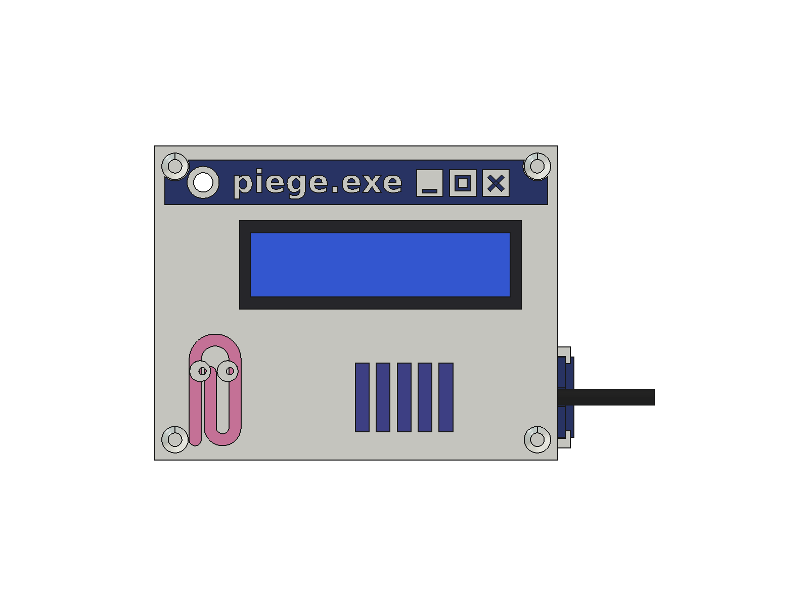

# EventBadge enclosure

3D-printed case for the badge: a Windows 95 window titled `piege.exe`, with Clippy
in relief, worn on a bag strap and powered by a power bank through a locked
micro-USB cable. Printed and validated on a single-extruder printer.



**Download the STL files:** [`enclosure-v1` release](https://github.com/rom98759/EventBadge/releases/tag/enclosure-v1).
Print settings, colours and assembly: [PRINT.md](PRINT.md).

## Layout

```
scripts/
  enclosure.py          final case: front, shell, USB lock, test corner, inlay front
  strap_clip.py         clip glued on the back for the bag strap
  explorations_abc.py   first A/B/C directions (rejected, kept for the record)
images/
  final/                renders of the chosen case
  explorations/         boards of the A/B/C directions and the V1/V2 variants
PRINT.md                print guide, filament changes, hardware, assembly
stl/  cad/  archive/    generated by the scripts, not versioned
```

## Regenerate

FreeCAD 1.1: *Macro › Execute macro* and pick the script, or in the Python console:

```python
p = "<repo>/enclosure/scripts/enclosure.py"; exec(open(p).read(), {"__file__": p})
p = "<repo>/enclosure/scripts/strap_clip.py"; exec(open(p).read(), {"__file__": p})
```

`enclosure.py` prints a report: `clashes` must be empty and `valid` `True` (it
checks every printed part against the modelled components). STL files land in
`stl/`, already oriented for printing; the FreeCAD model in `cad/`.
The title text uses DejaVu Sans Bold (`FONT`, Linux path).

## Design notes

- Axes: X width, Z height, Y depth; y = 0 is the back of the front plate, the
  visitor looks from −Y.
- The LCD is clamped between the front (its metal frame bears on the window edge)
  and four posts from the back with pins in its mounting holes.
- The Wemos sits loose; the USB overmold goes through a hole in the right side and
  a sliding lock in rails keeps it from being pulled out.
- Single-colour printer: colours come from filament changes at layer heights, or
  from inlay pieces glued into pockets.
